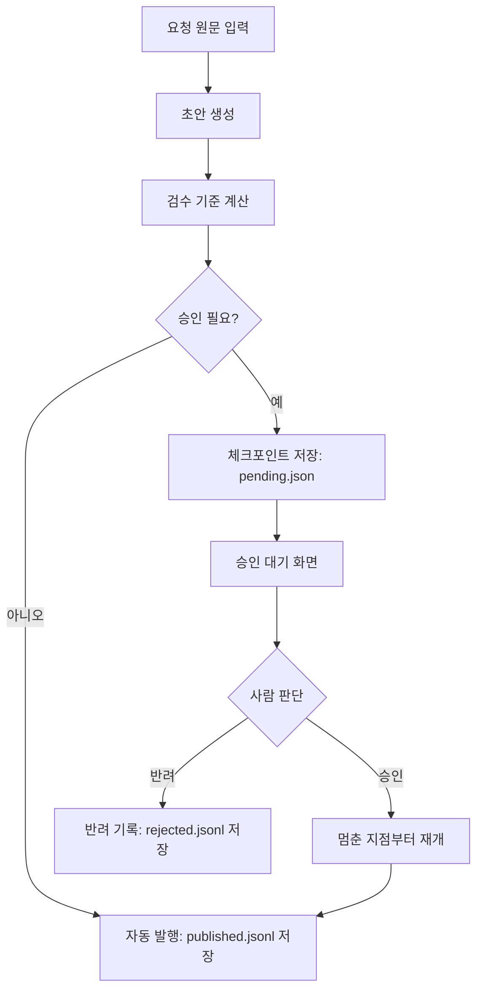
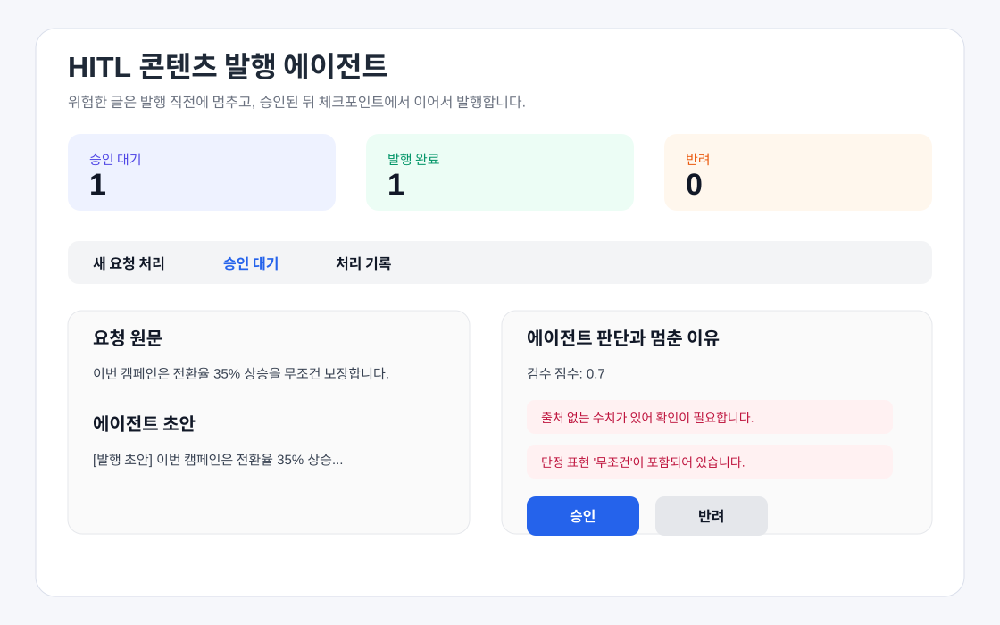

# REPORT.md

## 1. 주제와 고른 이유

이 프로젝트는 `콘텐츠 자동 발행 승인 에이전트`입니다. 뉴스레터, 블로그 글, 마케팅 문구, SNS 예약 글처럼 외부 사용자에게 나가는 콘텐츠를 자동으로 만들되, 위험한 글만 발행 직전에 사람에게 승인받는 업무를 자동화했습니다.

실제 서비스 예시는 다음과 같습니다.

- 뉴스레터를 구독자에게 보내기 전 검수
- 블로그 글을 공개 발행하기 전 승인
- 마케팅 문구를 캠페인 페이지에 올리기 전 승인
- SNS 글을 예약 발행하기 전 승인

사용자가 발행하고 싶은 글 요청을 입력하면 에이전트가 초안을 만들고, 수치 출처와 표현 위험, 품질 점수를 검사한 뒤 발행 여부를 결정합니다.

결과가 바깥으로 나가는 단계는 `data/published.jsonl`에 발행 완료 기록을 저장하는 순간입니다. 실제 서비스라면 이 단계가 블로그 발행, 뉴스레터 발송, SNS 게시에 해당합니다. 이 프로젝트에서는 API 키 없이 제출할 수 있도록 파일 저장으로 외부 발행을 모의했습니다.

이 주제를 고른 이유는 콘텐츠 발행이 잘못되면 잘못된 수치, 과장 표현, 낮은 품질의 문장이 그대로 사용자에게 전달될 수 있기 때문입니다. 동시에 모든 글을 사람이 확인하면 자동화 효과가 떨어지므로 위험한 건만 멈추는 HITL 구조를 보여 주기에 적합합니다.

## 2. 파이프라인 구조도



상태 흐름은 다음과 같습니다.

| 상태 | 저장 위치 | 설명 |
|---|---|---|
| 요청 입력 | 메모리 | 사용자가 새 콘텐츠 요청을 입력합니다. |
| 검수 완료 | 메모리 | 에이전트가 초안과 판단 근거를 만듭니다. |
| 승인 대기 | `data/pending.json` | 발행 직전 멈춘 상태입니다. 앱을 껐다 켜도 이어서 처리할 수 있습니다. |
| 발행 완료 | `data/published.jsonl` | 자동 발행 또는 사람 승인 뒤 발행된 상태입니다. |
| 반려 | `data/rejected.jsonl` | 사람이 외부 발행을 막은 상태입니다. |

## 3. 승인 기준과 그 이유

| 기준 | 계산 방법 | 막으려는 위험 | 자동 처리해도 되는 이유 |
|---|---|---|---|
| 출처 없는 수치 | `%`, `원`, `명`, `배`, `건` 등 단위가 붙은 숫자가 있는데 `출처:`, `자료:`, URL이 없으면 승인 필요 | 근거 없는 성과 수치나 가격 정보가 외부에 나가는 위험 | 수치가 없거나 출처가 있으면 사실 검증 위험이 낮습니다. |
| 품질 점수 0.75 미만 | 초안 길이, 행동 안내 포함 여부, 출처 없는 수치, 민감어 여부를 감점해 계산 | 너무 짧거나 맥락이 부족한 글이 발행되는 위험 | 기준 이상이면 기본 구조와 안내가 들어 있어 사람이 매번 볼 필요가 낮습니다. |
| 민감/단정 표현 포함 | `무조건`, `확실히`, `투자 보장`, `완치`, `부작용 없음`, `최고` 포함 여부 검사 | 과장 광고, 법적 문제, 브랜드 신뢰도 하락 위험 | 해당 표현이 없으면 표현 리스크가 낮아 자동 발행할 수 있습니다. |

승인 기준은 `pipeline.py`의 `evaluate()` 함수에 계산 가능한 규칙으로 구현했습니다.

## 4. 실행 결과

`python pipeline.py`로 자체 검증을 실행했습니다.

처리한 예시는 총 2건입니다.

| 항목 | 건수 |
|---|---:|
| 전체 처리 | 2건 |
| 사람 승인 없이 자동 발행 | 1건 |
| 승인 기준에 걸려 멈춘 건 | 1건 |
| 사람이 승인한 건 | 1건 |
| 사람이 반려한 건 | 0건 |

| 입력 | 결과 | 이유 |
|---|---|---|
| 신규 기능 업데이트 안내. 사용자는 설정 화면에서 알림을 켤 수 있습니다. | 자동 발행 | 수치와 민감어가 없고 품질 점수가 기준 이상입니다. |
| 이번 캠페인은 전환율 35% 상승을 무조건 보장합니다. | 승인 대기 후 승인 | 출처 없는 수치와 단정 표현 `무조건`이 있어 발행 직전에 멈췄습니다. 사람이 메모를 남기고 승인하면 `published.jsonl`에 저장됩니다. |

사람이 처리한 방식은 다음과 같습니다. 승인 대기 목록에서 멈춘 건을 열어 요청 원문, 초안, 검수 점수, 멈춘 이유를 확인했습니다. 이후 검토 메모에 `수치 출처 확인 후 승인`을 남기고 승인 버튼을 눌러 멈춘 지점부터 재개했습니다. 그 결과 해당 건은 `data/published.jsonl`에 발행 완료 상태로 저장되었습니다.

자체 검증 결과는 다음과 같습니다.

```text
self_check passed
```

## 5. 데모 화면 설계

승인 화면에는 다음 정보를 보여 주기로 했습니다.

- 요청 원문
- 에이전트가 만든 초안
- 검수 점수
- 승인 필요 여부
- 멈춘 이유
- 승인하면 일어나는 일
- 검토 메모 입력란
- 승인 버튼과 반려 버튼

일부러 뺀 정보는 다음과 같습니다.

- 실제 이메일/블로그/SNS 발송 기능: 과제 검증에는 발행 직전 멈춤과 재개가 핵심이므로 로컬 파일 저장으로 대체했습니다.
- LLM API 키 입력란: 저장소에 API 키가 들어갈 위험을 없애기 위해 규칙 기반 초안 생성으로 구현했습니다.
- 복잡한 사용자 권한 관리: 1인 검수 데모에서는 필요하지 않아 제외했습니다.

데모 화면 캡처 이미지는 다음과 같습니다.



## 6. 프로젝트 회고

가장 공들인 부분은 승인 대기 상태를 `pending.json`에 저장해 앱을 껐다 켜도 이어서 처리할 수 있게 만든 점입니다. 단순히 화면에서만 멈추는 것이 아니라 체크포인터에 저장되므로 과제의 HITL 조건을 직접 확인할 수 있습니다.

앞으로 보완하고 싶은 점은 실제 LLM을 연결해 초안 품질을 높이는 것입니다. 다만 제출용 데모에서는 API 키 없이도 재현 가능해야 하므로 이번 버전은 규칙 기반 에이전트로 구현했습니다. 실제 서비스로 확장한다면 발행 채널 API 연동, 승인자 계정, 수정 후 승인 기능을 추가할 수 있습니다.
